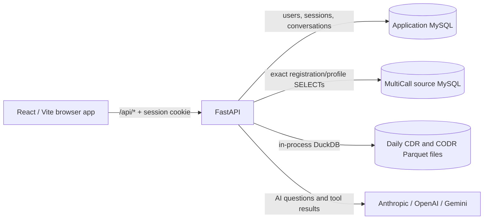
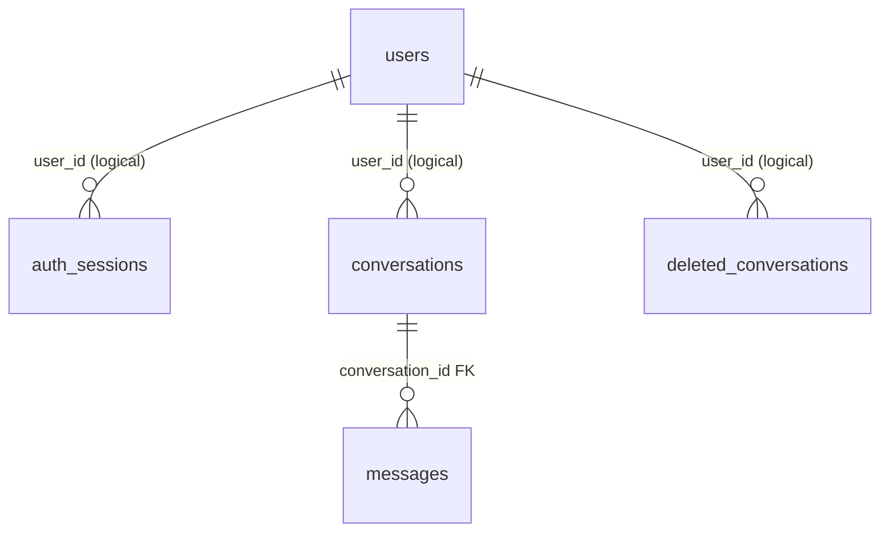
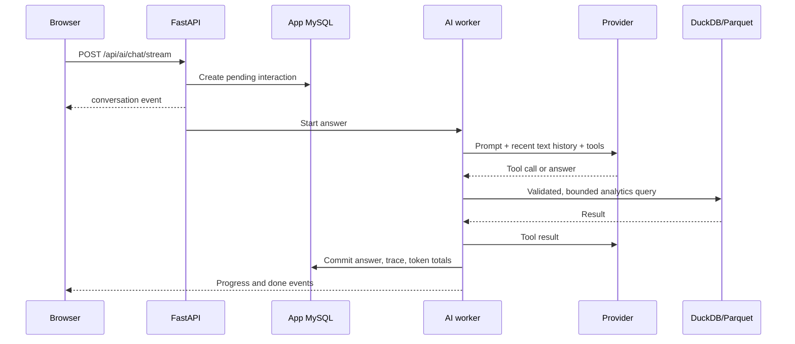

# DSNL Analytics: architecture and system design

This document describes the implementation in this repository. It is intended for developers changing the API, query logic, frontend, or deployment. For installation commands and an environment template, start with [README.md](README.md). For the assistant's detailed design, see [agent_document.md](agent_document.md). The design here distinguishes three data stores: the CDR/CODR Parquet lake, the application's MySQL state database, and the separate MySQL connection used for MultiCall registration lookup.

## Contents

- [System overview](#system-overview)
- [Repository map](#repository-map)
- [Data model and storage](#data-model-and-storage)
- [Backend request flows](#backend-request-flows)
- [Frontend design](#frontend-design)
- [API map](#api-map)
- [Performance and failure behavior](#performance-and-failure-behavior)
- [Security and deployment boundaries](#security-and-deployment-boundaries)
- [Development workflow](#development-workflow)
- [Current limitations](#current-limitations)

## System overview

DSNL Analytics serves read-only call analytics for Voicedrop, Conference, and Multicall; single-day campaign breakdowns; a natural-language assistant over the call lake; and a focused MultiCall registration/profile lookup. The browser is a React/TypeScript application. FastAPI owns authentication, validation, data access, and AI orchestration.



The three paths have different ownership and write behavior:

| Path | Source of truth | Access pattern | Writes by this application |
| --- | --- | --- | --- |
| Attempt Metrics, Campaign Metrics, AI analytics tools | Daily `cdr_YYYYMMDD.parquet` and `codr_YYYYMMDD.parquet` files | DuckDB reads selected files in place | None to the lake |
| Identity, sessions, AI conversation history | `DATABASE_URL` | SQLAlchemy ORM | Yes, including sessions and chat state |
| MultiCall Registration Lookup | `MULTICALL_DATABASE_URL`, tables `MultiCallRegistration` and `MultiCallProfile` | Bounded, on-demand SQLAlchemy Core SELECTs | None to the source database |

In development, Vite serves the browser and proxies `/api` to FastAPI on port 8001. A production web server should serve the built frontend and proxy `/api` to the backend; no production web-server configuration is included here. DuckDB is embedded in the backend process, not a separate database service.

## Repository map

| Location | Responsibility |
| --- | --- |
| [backend/app/main.py](backend/app/main.py) | FastAPI creation, lifespan, router registration, CORS, protected API docs, health route |
| [backend/app/core/config.py](backend/app/core/config.py) | Cached Pydantic settings loaded from environment or `backend/.env` |
| [backend/app/core/database.py](backend/app/core/database.py) | Application-state SQLAlchemy engine, session factory, declarative base |
| [backend/app/api/](backend/app/api/) | HTTP contracts and access control for auth, CDR, campaign, MultiCall, and AI |
| [backend/app/schemas/](backend/app/schemas/) | Pydantic request and response schemas for auth and analytics |
| [backend/app/models/](backend/app/models/) | Application-owned MySQL tables: users, sessions, conversations, interactions, archive |
| [backend/app/cdr/](backend/app/cdr/) | Parquet discovery, shared filters, dashboard and campaign DuckDB queries |
| [backend/app/multicall/service.py](backend/app/multicall/service.py) | Read-only production MultiCall source lookups |
| [backend/app/ai/](backend/app/ai/) | Prompt, provider adapters, bounded tool loop, SQL guard, background chat jobs, conversation persistence |
| [backend/scripts/migrate_ai_chat.py](backend/scripts/migrate_ai_chat.py) | Application-state schema/data migration; does not target the MultiCall source |
| [backend/tests/](backend/tests/) | SQLite and fixture-Parquet tests, plus optional live Gemini tests |
| [frontend/src/App.tsx](frontend/src/App.tsx) | React Query provider, route tree, lazy feature pages |
| [frontend/src/components/Layout.tsx](frontend/src/components/Layout.tsx) | Authenticated shell, navigation, header date controls, theme toggle, page slots |
| [frontend/src/store/index.ts](frontend/src/store/index.ts) | Zustand auth/UI state and shared analytics date selections |
| [frontend/src/services/api.ts](frontend/src/services/api.ts) | Shared auth API and HTTP error types |
| [frontend/src/features/](frontend/src/features/) | CDR dashboard, campaign metrics, AI chat, and MultiCall lookup UI/API modules |
| [frontend/src/index.css](frontend/src/index.css) | Tailwind theme tokens, branded surfaces, and shared motion |

Keep HTTP concerns in `app/api`, validation in `app/schemas`, and query logic in the corresponding service module. Feature-specific frontend API calls live beside their pages.

## Data model and storage

### Application MySQL

[backend/app/models/user.py](backend/app/models/user.py), [session.py](backend/app/models/session.py), and [conversation.py](backend/app/models/conversation.py) define the application-owned tables:



- `users` has an internal numeric primary key, a stable public UUID `user_id`, `username`, `password_hash`, and `ai_permission`. Despite its name, `password_hash` currently contains a plaintext password and is compared directly at login.
- `auth_sessions` stores the SHA-256 hash of a random cookie token as its primary key, plus the user's UUID, issue/expiry/last-seen times, and user agent. The raw token is sent only in an HTTP-only cookie.
- `conversations` stores an owner UUID, title, timestamps, and accumulated input/output token counts. `messages` stores one question/answer interaction per row with `pending`, `pass`, `fail`, or `stopped` status and a JSON trace of tool calls.
- `deleted_conversations` keeps a snapshot of an archived thread and its interactions. Deleting from the UI archives the conversation in one transaction rather than discarding its transcript.

The `user_id` relationships above are application-enforced, not foreign keys. `messages.conversation_id` is a foreign key with cascading deletion. FastAPI currently runs `Base.metadata.create_all()` against `DATABASE_URL` during startup; it creates missing application tables but does not alter existing ones. The migration script handles existing user/chat schema changes and can rebuild legacy `messages`, so review and back up the application database before running it. No migration or startup code points at `MULTICALL_DATABASE_URL`.

### CDR/CODR lake

[lake.py](backend/app/cdr/lake.py) lists the two configured directories, parses dates from filenames, and caches directory listings for 10 seconds. A requested inclusive date range resolves to only the files present in that range. Missing days are skipped and surfaced in coverage metadata. No ingest, copy, or MySQL import is performed.

`cdr` contains call legs; `codr` contains conference-room records. When a query needs both, it joins on **`CRN` and `CONF_NUM`**; `CRN` alone is reused and can multiply rows. The service classifier uses `codr.MODULE_TYPE` for Conference (1) and Multicall (4), while Voicedrop can be identified by `cdr.CONFEREE_TYPE = 6` without a CODR join. The CDR dashboard's connected test is `INCONF_DATETIME_EPOC <> 0`. Billable minutes sum per-connected-leg time from the in-conference epoch to the release epoch, rounding each leg up before summing. `CALLTYPE = 0` is Dial In and `1` is Dial Out in the implemented queries.

These rules live in [filters.py](backend/app/cdr/filters.py), [service.py](backend/app/cdr/service.py), [campaign_service.py](backend/app/cdr/campaign_service.py), and the AI [schema prompt](backend/app/ai/schema_prompt.py). When changing a domain rule, review all four; the campaign service deliberately maintains its own single-day filter shape.

### MultiCall source MySQL

The Registration Lookup is a different source from the CDR/CODR lake. `MultiCallRegistration.RegNum` identifies a registration. `MultiCallProfile` belongs to a registration through `RegNum` and has a profile reference number unique within that registration. The current page reads these two tables only; it does not query `MultiCallCallHistory`.

The source engine in [backend/app/multicall/service.py](backend/app/multicall/service.py) requires `MULTICALL_DATABASE_URL`. It never falls back to the application-state `DATABASE_URL`. Use a dedicated account with SELECT privileges on the source tables. The application issues no CREATE, ALTER, index, or temporary-table statement against this source. MySQL may still use its own existing indexes or internal execution structures.

## Backend request flows

### Authentication and authorization

`POST /api/auth/login` finds a user by username, compares the password, creates a random session token, stores only its SHA-256 hash, and sets an HTTP-only cookie. On protected requests, [deps.py](backend/app/api/deps.py) hashes the cookie, loads the session, checks its stored expiry, updates `last_seen_at`, and resolves the user. Thus a normal protected request also reads and writes the **application-state** database. `POST /api/auth/logout` removes the session row and clears the cookie.

The CDR, campaign, and MultiCall routers require any authenticated user. AI routes additionally require `users.ai_permission`. AI conversation reads and mutations are scoped to `user_id`; a missing or another user's conversation returns the same 404. `/health` and login are public; logout is intentionally idempotent without a session. Swagger UI, ReDoc, and OpenAPI JSON are session-protected.

### Attempt Metrics

1. The frontend loads `GET /api/cdr/status` to learn lake coverage and a default day. The date range is required and capped by `CDR_MAX_RANGE_DAYS`.
2. Changing the service/date/filter produces a `POST /api/cdr/query/dashboard` request. Typed filters are debounced in the dashboard page; service and date changes apply immediately.
3. [service.py](backend/app/cdr/service.py) chooses daily files, adds bound WHERE parameters, and joins CODR only when a filter or output needs it. A materialized `slice` CTE projects the required columns once; panel-specific aggregate branches are combined with `UNION ALL` in one DuckDB statement and reshaped for the API.
4. The frontend also requests `/api/cdr/query/call-cube` for the joint location/connection/direction/provider distribution used by chart hover breakdowns. This is a second, independent lake query.

The service exposes single-panel, raw-record, by-date, and by-account endpoints for other clients. Raw records use a count plus a paginated row query; they are not the dashboard's normal loading path. Peak ports is calculated with a start/release interval sweep rather than an unreliable port-count column.

### Campaign Metrics

Campaign requests take exactly one `date` and one service. [campaign_service.py](backend/app/cdr/campaign_service.py) reads that day's CDR file and joins CODR for Conference/Multicall. Account, carrier, and location views are separate aggregates. The account view groups by CRN first, then rolls up so an expanded account matches its child rows. Connected size uses distinct `(CRN, CONFEREE_SEQ_NO)` identities; not-connected size is total minus connected.

The frontend requests only the active view. Account search is debounced and evaluated server-side because CRN and CPIN are not present in the account list payload. Expanding an account lazily requests its CRNs; opening its chart dialog lazily requests `account-insight`. The insight endpoint builds most panels from one materialized slice and, for Conference/Multicall, runs a separate room-identity query. CSV export is produced in the browser from the currently filtered/sorted rows.

### MultiCall Registration Lookup

The route `/analytics/multicall/registry` is a three-stage master/detail view: explicit search, choose a registration, choose a profile. It intentionally has no dashboard, automatic search-on-typing, date picker, or call-history read.

| User action | Source-database work |
| --- | --- |
| Open page or type in the input | None |
| Press **Search** for exact phone, email, or chairperson PIN | One bounded SELECT; at most 25 registrations returned |
| Select a registration | One joined SELECT for its details and up to 50 profiles |
| Press **Load more profiles** | One additional bounded SELECT for the requested page |
| Select a loaded profile | None; details come from the fetched page |

Phone and email search registration contacts and linked profile contacts; CPIN searches `MultiCallProfile.ChairpersonPin`. Search is a POST so the PIN does not enter the URL. Profile chairperson/participant PINs are masked before the API responds. The React detail query is disabled until a registration is selected and has no focus/reconnect refetch. A missing source URL or source access problem returns 503 rather than silently querying the application database.

### AI assistant

The browser normally uses `POST /api/ai/chat/stream` and parses server-sent events from a POST response. The backend creates a conversation/interaction row before answering, then runs the blocking provider/tool loop in its own thread with its own database session. The stream observes progress; closing the browser stops observation but the worker continues and commits. On a reload, the UI reads the stored conversation and polls pending interactions every two seconds. Explicit Stop records `stopped` and signals the in-process worker; a worker in another process observes the stored status before committing.



[orchestrator.py](backend/app/ai/orchestrator.py) speaks provider-neutral messages and offers three tools in preferred order:

| Tool | Design |
| --- | --- |
| `query_metrics` | Fixed measures and up to two dimensions; bound filters; primary path for totals, rates, and grouped questions |
| `get_cdr_panel` | Existing fixed dashboard panels and by-account/by-date breakdowns |
| `run_cdr_query` | Last-resort model-written SELECT, validated by [sql_guard.py](backend/app/ai/sql_guard.py) |

The ad hoc tool validates a single SELECT/WITH statement, known table targets, forbidden operations/file functions, and an outer result-row cap. It then creates **temporary tables inside a fresh DuckDB connection** from the selected Parquet days and attempts to disable local filesystem access before running model SQL. Those temp tables are neither in MySQL nor persistent. If the DuckDB filesystem restriction fails, current code logs the failure and continues with text validation only; see [Current limitations](#current-limitations).

The loop is capped by `AI_MAX_TOOL_ROUNDS`, and tool calls are recorded with each interaction. Only the last ten interactions are replayed as text: their questions and any successful answers. Old tool calls are retained for audit but not replayed to a provider. Provider selection is lazy: explicit `AI_PROVIDER` or first configured key in Anthropic, OpenAI, Gemini order. Each adapter translates the neutral tool protocol and token usage into its SDK's format. Chat cost shown in the UI is an estimate using configured per-million-token rates, not a provider bill.

## Frontend design

React Router defines the URL as the source of navigation state. Feature pages are lazy-loaded to keep chart and chat code out of the initial bundle. [RequireAuth.tsx](frontend/src/components/RequireAuth.tsx) starts in an `unknown` state, asks `/api/auth/me`, and redirects anonymous users to Login while preserving the attempted path. The backend cookie, not Zustand, is the authorization source of truth.

| Route family | Page | Data behavior |
| --- | --- | --- |
| `/analytics/{all,voicedrop,conference,multicall}/attempt-metrics` | CDR dashboard | Lake status, dashboard query, call-cube query |
| `/analytics/{voicedrop,conference,multicall}/campaign-metrics` | Campaign Metrics | Active table view, lazy CRN and insight requests |
| `/analytics/multicall/registry` | Registration Lookup | Search button, then selected registration/profile |
| `/assistant` and `/assistant/:conversationId` | AI chat | URL identifies thread; SSE for live answers, polling after reload |

The shared [Layout](frontend/src/components/Layout.tsx) owns navigation and the shell. The page-owned filters render into its header through [HeaderSlot](frontend/src/components/HeaderSlot.tsx); dialogs can render inside the content card through [ContentPanelSlot](frontend/src/components/ContentPanelSlot.tsx). The global CDR range picker is hidden on AI chat and MultiCall Registration Lookup; Campaign Metrics uses its own single-day picker.

State is split by lifetime and responsibility:

- Zustand holds auth display state (`unknown`/`authenticated`/`anonymous`), theme preference, and shared analytics dates. Only the username and theme are persisted; an authenticated claim is never trusted from local storage.
- TanStack Query caches lake status, dashboard/campaign results, conversation lists, and selected MultiCall registration pages. The MultiCall search uses a mutation so it cannot fire on every keystroke.
- Component state holds active tabs, filters, selected rows, chat presentation, and dialogs. The assistant conversation ID lives in the URL, not a parallel store.
- [index.css](frontend/src/index.css) defines Tailwind brand tokens, dark-mode surfaces, and shared animation. Page components render charts/tables and limited display calculations; source queries and core analytics formulas live in Python.

## API map

All paths below are relative to the backend host. Except for login, logout, and health, they require a live session; `/api/ai/*` additionally requires AI permission.

| Area | Endpoints |
| --- | --- |
| Health/docs | `GET /health`; protected `GET /docs`, `/redoc`, `/openapi.json` |
| Auth | `POST /api/auth/login`, `POST /api/auth/logout`, `GET /api/auth/me` |
| Lake/CDR | `GET /api/cdr/status`; `POST /api/cdr/query/dashboard`, `/records`, `/by-date`, `/by-account`, `/call-cube`; single-panel routes declared in [api/cdr.py](backend/app/api/cdr.py) |
| Campaign | `POST /api/campaign/account-wise`, `/account-wise/crn`, `/account-insight`, `/service-provider-wise`, `/location-wise` |
| MultiCall lookup | `POST /api/multicall/search`; `GET /api/multicall/registrations/{reg_num}?page=1` |
| AI | `POST /api/ai/chat`, `/chat/stream`; `GET /api/ai/conversations` and `/{id}`; `PATCH`/`DELETE /api/ai/conversations/{id}`; `POST /api/ai/conversations/{id}/stop` |

FastAPI/Pydantic return 422 for invalid bodies. Lake queries that cannot cover the requested range return 409. An unavailable MultiCall source or unconfigured AI provider returns 503. Provider/tool-loop failures return 502 for the non-streaming AI route and an error event once an SSE response has begun. Missing or unowned chat conversations return 404.

## Performance and failure behavior

- File pruning starts with filenames; each request opens only the requested daily exports. The lake's directory listing is cached briefly, and `/api/cdr/status` is cached client-side for one minute.
- CDR dashboard panels share one materialized query; the call cube is a separate query because it has a different joint-dimension shape. CODR is joined only when needed.
- The CDR date span defaults to at most 31 days (`CDR_MAX_RANGE_DAYS`). Raw rows have a 1,000-row request maximum and the service applies `CDR_MAX_ROWS_PER_QUERY`, default 5,000. Campaign queries are single-day.
- AI tools have their own date-span limit, result-row cap, and round budget (`AI_MAX_RANGE_DAYS`, `AI_MAX_ROWS_TO_MODEL`, `AI_MAX_TOOL_ROUNDS`). The ad hoc path materializes the selected range and can use substantial process memory; it is not the default tool.
- MultiCall source reads occur only after explicit user actions, with 25 search results and 50 profiles per page. Profile selection is client-only. Normal session validation still reads and updates application-state MySQL on protected requests.
- Missing lake files/directories are reported as unavailable rather than zero activity. Missing `MULTICALL_DATABASE_URL` disables only the registration lookup. Missing AI credentials disable only AI chat.
- AI background work survives a browser disconnect, but it is an in-process thread, not a durable queue; a backend process crash or restart can strand a pending interaction.

## Security and deployment boundaries

The backend protects analytics routers at registration in [main.py](backend/app/main.py), rather than relying on each handler to remember a guard. AI adds `ai_permission` and owner scoping. Session cookies are HTTP-only and configurable for Secure/SameSite; enable HTTPS and `SESSION_COOKIE_SECURE=true` outside local development. Search values use bound SQL parameters. The MultiCall source credential should have SELECT only, and the UI masks profile PINs in API results.

Treat the following as implementation facts when deploying or extending the system:

- `users.password_hash` contains plaintext passwords today. Replace direct comparison with a password KDF and migrate stored credentials before treating the login boundary as suitable for untrusted users.
- Access control is coarse-grained: authenticated versus `ai_permission`. There is no general role hierarchy or per-account analytics authorization.
- CORS is currently configured with `allow_origins=["*"]` and credentials. Restrict it to the deployed frontend origin. Session cookies use `SameSite=lax` by default; review CSRF protection for any new state-changing endpoint.
- The application's own MySQL connection needs schema privileges at startup because `create_all` runs there. The chat migration can ALTER tables, create an application-state index/trigger, and rebuild legacy messages. The separate MultiCall connection performs only SELECTs.
- The model receives questions and tool outputs through an external provider. AI ad hoc SQL is logged for audit. Review data classification and logging before enabling AI on sensitive call records.
- The SQL guard is text-based, and the DuckDB filesystem restriction is currently best-effort. Do not describe ad hoc AI SQL as a proven sandbox if disabling the filesystem fails.
- Campaign Metrics can return CODR chairperson PINs in CRN/insight responses to any authenticated user; the separate Registration Lookup masks profile PINs. Account for this distinction in access reviews.

## Development workflow

Use [README.md](README.md#getting-started) for prerequisites, backend/frontend setup, the example `.env`, and startup commands. Configuration is defined in [config.py](backend/app/core/config.py), with an example in [backend/.env.example](backend/.env.example). Run the backend from `backend/` so Pydantic can find its relative `.env` file. The Vite development proxy is configured in [frontend/vite.config.ts](frontend/vite.config.ts).

```bash
# From backend/ with the virtual environment active
python -m pytest -q

# From frontend/
npm run lint
npm run build
```

Most backend tests use temporary SQLite databases and a generated two-file Parquet lake, so they do not need production data. [test_multicall.py](backend/tests/test_multicall.py) verifies exact searches, bounded paging, session protection, and one SELECT per explicit source action. [test_ai_gemini_live.py](backend/tests/test_ai_gemini_live.py) is an optional real-provider integration test and runs when `GOOGLE_API_KEY` is configured; it uses fixture Parquet files but makes a network call.

For common changes:

1. **New CDR metric:** define the domain rule in the backend query service or fixed AI measure table, update the Pydantic and TypeScript contracts, then add a fixture-backed assertion for the arithmetic. Keep service classification and the `(CRN, CONF_NUM)` join consistent.
2. **New campaign breakdown:** extend the single-day campaign service/schema/API, then its feature API and view. Keep CRN children and account totals reconcilable.
3. **New MultiCall field:** add only the columns needed by the selected screen to the bounded source SELECT and response type; keep the source connection separate, SQL bound/read-only, and searches button-triggered.
4. **New AI provider/tool:** implement the neutral `LLMClient` interface or a `ToolSpec` plus dispatcher entry; update the system prompt and test the round budget, errors, and token accounting.
5. **New API route:** attach it to the correct guarded router, add ownership checks for per-user records, and keep application-state writes out of the source-data services.

## Current limitations

This is a code-level architecture description, not a certification of production readiness. The most important gaps are plaintext stored passwords, no general RBAC beyond the AI permission flag, permissive CORS, application-table creation during startup, and best-effort filesystem lockdown for AI ad hoc SQL. The AI worker is process-local, and there is no durable job queue or cross-process progress replay. The repository also has differing version labels: [README.md](README.md) presents product version 1.0, while FastAPI and the frontend package currently identify themselves as 2.0. Resolve that before publishing a versioned release.
