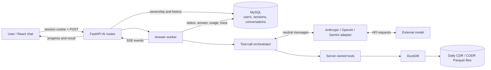

# AI Agent Implementation Design

This document describes the **implemented** natural-language analytics assistant in DSNL Analytics 1.0. It is for developers maintaining the agent, its data tools, provider integrations, API, and chat interface. For the wider application architecture and setup, see [DOCUMENT.md](DOCUMENT.md) and [README.md](README.md).

## Contents

- [Purpose and boundaries](#purpose-and-boundaries)
- [Architecture at a glance](#architecture-at-a-glance)
- [Technology and component map](#technology-and-component-map)
- [How a question is answered](#how-a-question-is-answered)
- [Provider abstraction](#provider-abstraction)
- [Prompt and domain model](#prompt-and-domain-model)
- [Data tools and query execution](#data-tools-and-query-execution)
- [SQL controls and trust boundaries](#sql-controls-and-trust-boundaries)
- [Conversation memory and usage](#conversation-memory-and-usage)
- [Streaming, stopping, and recovery](#streaming-stopping-and-recovery)
- [API and frontend contract](#api-and-frontend-contract)
- [Configuration](#configuration)
- [Testing and extension guide](#testing-and-extension-guide)
- [Current operational limitations](#current-operational-limitations)

## Purpose and boundaries

The assistant answers questions about conference, voicedrop, and multicall **call-detail analytics** in plain English. It translates a question into a call to one of three server-owned tools, reads the result, and produces an answer with the date range and filters that make the figure meaningful. It can ask for clarification when the question cannot be mapped to a reliable query.

Its analytics source is the daily **CDR/CODR Parquet lake**. DuckDB queries that lake; the external model does not connect to the file share or to a database. MySQL, accessed through SQLAlchemy and PyMySQL, stores authentication state and chat history. The production MultiCall registration lookup is a separate feature with its own database connection and is **not an agent tool**.

The agent is read-only with respect to call-record data. It can write its own conversation and usage records in the application database. The query tools do not create persistent lake indexes or tables. The fallback ad hoc SQL tool does create **temporary tables inside a fresh, disposable DuckDB connection** for the selected date range; this is distinct from the direct Parquet reads used by the preferred metrics tool.

## Architecture at a glance



There are four boundaries to keep in mind:

1. **Browser to API:** the browser supplies a question and, for follow-ups, a conversation ID. It does not supply the authoritative user identity or model history.
2. **API to model:** the provider receives the system prompt, recent plain-text history, current question, tool definitions, and tool results. Tool results can contain call-record aggregates or rows, so provider data handling matters operationally.
3. **Model to tool:** the model proposes tool names and arguments; the backend validates and executes them. The model cannot invoke Python functions directly or choose a filesystem path through the preferred tools.
4. **Tool to lake:** DuckDB opens date-selected files from paths configured on the server. The date span and returned rows are bounded in code.

## Technology and component map

| Layer | Technology | Implementation |
|---|---|---|
| HTTP, validation, access control | FastAPI, Pydantic | [AI routes](backend/app/api/ai.py), [session dependencies](backend/app/api/deps.py) |
| Agent loop | Python, neutral dataclasses | [orchestrator](backend/app/ai/orchestrator.py), [provider contract](backend/app/ai/providers/base.py) |
| Model services | Anthropic, OpenAI, Google Gemini SDKs | [provider factory](backend/app/ai/providers/factory.py) and sibling adapters |
| Analytics | DuckDB, daily Parquet exports | [metrics](backend/app/ai/tools/metrics.py), [panel wrapper](backend/app/ai/tools/structured.py), [ad hoc SQL](backend/app/ai/tools/ad_hoc_sql.py) |
| State | SQLAlchemy, PyMySQL / MySQL | [conversation service](backend/app/ai/conversations.py), [models](backend/app/models/conversation.py) |
| Background streaming | Python threads and queues, Server-Sent Events | [jobs](backend/app/ai/jobs.py), [AI routes](backend/app/api/ai.py) |
| Chat UI | React, TypeScript, Vite, TanStack Query | [chat page](frontend/src/features/ai-chat/pages/AiChatPage.tsx), [hook](frontend/src/features/ai-chat/hooks.ts), [client](frontend/src/features/ai-chat/api.ts) |
| Settings | `pydantic-settings` | [configuration](backend/app/core/config.py) |

The relevant backend package is `backend/app/ai/`. The relevant frontend feature is `frontend/src/features/ai-chat/`. The dashboards and agent share the [CDR lake discovery and analytics rules](backend/app/cdr/) where possible.

## How a question is answered

### Request lifecycle

1. The user submits a question from `/assistant` or `/assistant/:conversationId`. The normal UI uses `POST /api/ai/chat/stream`.
2. FastAPI validates the request: a question has 1–4,000 characters and the optional conversation ID has at most 36 characters. The [router](backend/app/main.py) requires an authenticated session with `ai_permission`. The endpoint derives the user from that session.
3. The provider factory selects a configured client. If no usable provider key exists, the request returns HTTP 503 **before** the SSE stream starts.
4. The API finds or creates an owned conversation, loads the most recent ten interactions as text history, inserts a `pending` interaction, and commits it. A first question becomes the initial conversation title.
5. The streaming endpoint emits the conversation ID immediately, then starts a worker with its own SQLAlchemy session. The worker calls [`answer_events`](backend/app/ai/orchestrator.py).
6. For each round, the orchestrator sends the constant system prompt, full neutral in-flight history, and all three tool schemas to the selected model. It records the model's input and output token counts.
7. If the model asks for tools, the orchestrator runs those calls **sequentially**, emits start/end progress events, and returns their text results to the model in one grouped neutral message. A bad tool name, invalid arguments, rejected SQL, or tool exception becomes an error result the model can correct in another round.
8. When the model finishes, or the round budget is exhausted, the worker commits the answer, tool-call trace, and usage totals. It then emits the final `done` event. The frontend renders the answer and refreshes the conversation list.

```mermaid
sequenceDiagram
    participant UI as React chat
    participant API as FastAPI
    participant DB as MySQL
    participant Worker as Answer worker
    participant LLM as Provider adapter
    participant Tool as DuckDB tool
    UI->>API: POST /api/ai/chat/stream
    API->>DB: Load history; insert pending interaction
    API-->>UI: conversation event
    API->>Worker: Start answer
    loop Up to AI_MAX_TOOL_ROUNDS
        Worker->>LLM: System prompt + history + tool schemas
        LLM-->>Worker: Final text or tool calls
        opt Tool calls requested
            Worker->>Tool: Validated arguments
            Tool-->>Worker: Result or recoverable error
            Worker-->>UI: tool_start / tool_end
        end
    end
    Worker->>DB: Commit answer, trace, tokens, status
    Worker-->>UI: done event
```

The blocking `POST /api/ai/chat` route uses the same orchestrator via [`answer()`](backend/app/ai/orchestrator.py), which drains the event generator and returns one JSON response. It does not use the background worker.

### Round budget and tool failures

`AI_MAX_TOOL_ROUNDS` defaults to five **model turns**, not five database queries. One model turn may request multiple tools, which are executed one after another. The loop collects every tool request in the `queries` trace as `{tool, input, error}`. A final response contains the provider, model, trace, and token totals across all rounds. On budget exhaustion it returns a fixed message asking the user to narrow the question, while preserving the trace and tokens already spent.

## Provider abstraction

[`providers/base.py`](backend/app/ai/providers/base.py) defines a small vendor-neutral protocol:

- `LLMClient.send(system, history, tools) -> LLMTurn` is the only call the orchestrator makes.
- `ToolSpec` holds a name, description, and JSON Schema arguments.
- `NeutralMessage` holds text, tool calls, or tool results. All results from one model turn are grouped into one neutral user message.
- `ToolCallRequest` pairs a call ID, name, and arguments; `ToolResult` pairs its result and error flag.
- `LLMTurn` normalizes returned text, requested tools, the `tool_use`/`end_turn` distinction, and per-call token usage.

The adapters translate these shapes into each provider's wire format on every request. Anthropic expects grouped tool results inside a user message; OpenAI uses separate tool-role messages; Gemini uses function-response parts. Gemini's opaque `thought_signature` is retained in `provider_meta` only for the active answer loop so a tool-call round trip remains valid; it is not stored as conversation history. Adapters are stateless, so subsequent questions can use another configured provider without converting a vendor-specific transcript.

[`factory.py`](backend/app/ai/providers/factory.py) reads [`Settings`](backend/app/core/config.py) and imports only the selected adapter. Set `AI_PROVIDER` explicitly to `anthropic`, `openai`, or `gemini`, or leave it unset to auto-detect the first present key in that order. Missing configuration raises `ProviderNotConfigured` at request time; analytics dashboards can start without an AI key. `AI_MODEL` overrides the selected adapter's built-in model default.

## Prompt and domain model

[`schema_prompt.py`](backend/app/ai/schema_prompt.py) builds one constant `SYSTEM_PROMPT` from schema notes, runtime limits, and behavior instructions. It tells the model what CDR and CODR represent, which measures are valid, when to ask a clarification question, which tool to try first, and how to present an answer. It also warns about domain traps that would otherwise yield plausible but incorrect numbers:

- CDR is a conferee **call leg**; CODR is a room instance. Join on **both** `CRN` and `CONF_NUM`.
- `CALLTYPE = 0` means dial-in; `1` means dial-out.
- A connected call uses `INCONF_DATETIME_EPOC <> 0`; a non-null-looking field is not an equivalent test.
- Service classification uses the appropriate CDR conferee type and CODR `MODULE_TYPE`. Multicall classification relies on CODR `MODULE_TYPE = 4`.
- Duration and billable-minute calculations use epoch fields and per-leg rules. Legacy or unused reblast fields are explicitly excluded.

The prompt tells the model to prefer one grouped query over many small queries, state date/filter context, disclose empty or truncated results, and avoid inventing figures. For multi-row breakdowns it asks for a Markdown table; the chat UI implements that limited format. **The prompt is guidance, not a security boundary.** Validation, allowlists, row caps, and access control live in backend code.

The prompt is built once at module import. Changing `AI_MAX_*` settings requires restarting the backend so the prompt and active settings describe the same limits.

## Data tools and query execution

The orchestrator offers tools in preferred order. The model is instructed to follow this order; the backend does not force a particular choice.

| Tool | Intended use | Query shape and controls |
|---|---|---|
| [`query_metrics`](backend/app/ai/tools/metrics.py) | Most totals, rates, rankings, and breakdowns | Backend-owned SQL expressions from measure/dimension allowlists; validated date/service/account/CRN filters; bound values; at most two grouping dimensions and 500 rows |
| [`get_cdr_panel`](backend/app/ai/tools/structured.py) | Existing dashboard shapes such as peak ports, funnel, duration buckets, or reblast sequence | Calls fixed functions in [`app.cdr.service`](backend/app/cdr/service.py) after Pydantic filter validation |
| [`run_cdr_query`](backend/app/ai/tools/ad_hoc_sql.py) | Questions neither earlier tool can express | Model-authored DuckDB `SELECT`/`WITH` over temporary `cdr`/`codr` tables, validated by [`sql_guard.py`](backend/app/ai/sql_guard.py), capped and audited |

### Preferred metrics path

`query_metrics` accepts one date range, optional service/account/CRN filters, requested measures, up to two `group_by` dimensions, sorting, and a limit. Its available measures are calls, connected, not connected, connect rate, minutes, phone numbers, conferences, accounts, reblasts, and DTMF entries. Dimensions include date, hour, location, account, provider, conference, direction, disconnect reason, blast, and service type. The tool constructs SQL only from its known expression maps; the model does not write this SQL. It discovers the daily Parquet files in range, reads them with DuckDB's `read_parquet`, and joins CODR only when the requested classification or dimension needs it.

The [lake module](backend/app/cdr/lake.py) selects files named `cdr_YYYYMMDD.parquet` and `codr_YYYYMMDD.parquet` under the configured roots and caches directory listings briefly. A date range therefore narrows the files opened on the network share. Missing CDR files are reported as missing data, not a zero-count answer. A service filter or grouping that requires CODR also checks CODR availability.

### Panel path

`get_cdr_panel` reuses the dashboard service functions for predefined panels. It adds `by_account` and `by_date` breakdowns. The agent-specific date ceiling is passed as validation context to `CdrFilter`, so the AI range limit can differ from the dashboard's own limit. Each call returns JSON or a recoverable error message.

### Ad hoc path

`run_cdr_query` is the fallback. It first validates the date range and SQL text. It then opens a **new in-process DuckDB connection**, materializes only the selected days into temporary `cdr` and `codr` tables, and runs the guarded statement. An empty CODR stub is created if the range contains CDR but no CODR files. The CDR materialization also applies a row-level date predicate because a file's date in its name does not prove that every contained row belongs to that day. The connection and its temporary tables disappear after the call.

This path can be materially more expensive than direct Parquet aggregation because it materializes rows before the model's query runs. Keep it a last resort and prefer a single grouped query over repeated small calls.

## SQL controls and trust boundaries

The backend checks model-produced SQL in [`sql_guard.validate`](backend/app/ai/sql_guard.py). It accepts one statement starting with `SELECT` or `WITH`, rejects a second statement, denies mutation and file-access keywords, rejects unknown `FROM`/`JOIN` targets other than `cdr`, `codr`, and same-statement CTEs, then wraps the query with an outer `LIMIT AI_MAX_ROWS_TO_MODEL`. This cap limits rows returned to the model; it is **not** a limit on rows scanned or the memory used while executing.

After temporary tables are built, the ad hoc tool tries to disable DuckDB's local filesystem for that connection before executing generated SQL. **Current behavior is fail-open for that step:** if the DuckDB setting fails, the code logs an error and continues with text validation alone. Do not describe this path as an unconditional filesystem sandbox. The SQL validator is regex-based and cannot prove that every possible DuckDB expression is safe. For a stricter deployment, make failure to disable file access fatal, use a least-privilege service account and read-only lake mount, and review the accepted SQL surface.

Other enforced boundaries are:

- [`AI_MAX_RANGE_DAYS`](backend/app/core/config.py) limits each AI tool's date span; the default is 31 days.
- [`AI_MAX_ROWS_TO_MODEL`](backend/app/core/config.py) caps ad hoc returned rows; `query_metrics` also has its own hard 500-row cap.
- [`AI_MAX_TOOL_ROUNDS`](backend/app/core/config.py) caps model turns per answer; it does not cap the total number of tool calls if a provider requests several in one turn.
- The predefined metrics and panel tools bind user-supplied filter values instead of interpolating them into SQL.
- [`require_ai_permission`](backend/app/api/deps.py) gates the entire AI router, and conversation endpoints scope records to the authenticated session's user.

Tool results and the recent conversation are sent to the selected external provider. Avoid adding raw sensitive columns or unrestricted row-dump tools without assessing that data boundary. The ad hoc SQL path logs its purpose, generated SQL, date range, and outcome; the interaction stores tool arguments in `queries` for the UI trace and audit. Logs and conversation storage may therefore contain sensitive identifiers.

## Conversation memory and usage

[`Conversation`](backend/app/models/conversation.py) stores a UUID string, owner, title, timestamps, and cumulative input/output tokens. Each [`Message`](backend/app/models/conversation.py) is one **question and answer interaction**, with status, question, response, token counts, and a JSON tool-call trace. Statuses are `pending`, `pass`, `fail`, and `stopped`. A [`DeletedConversation`](backend/app/models/conversation.py) holds a full archive snapshot when a user removes a thread from the active list.

The [conversation service](backend/app/ai/conversations.py) reconstructs only the latest ten interactions for a new question. It replays questions and successful answers as plain text; stored tool calls are for audit and display, **not** replayed to the provider. This keeps context bounded and avoids invalid vendor-specific tool-call history. An incomplete or failed question can appear without an invented assistant answer. A new conversation title is the first question trimmed to 120 characters.

The server, not the client, supplies ownership from the authenticated session. An existing conversation owned by another user yields HTTP 404. A client-supplied ID that does not exist creates a new conversation under that ID for the caller. Legacy rows without `user_id` remain readable and can be claimed when opened; this compatibility behavior should be considered when migrating old data.

Token counts accumulate across every provider round of an interaction and across the conversation. Displayed cost is an **estimate**:

```text
(input_tokens × AI_PRICE_INPUT_PER_MTOK
 + output_tokens × AI_PRICE_OUTPUT_PER_MTOK) / 1,000,000
```

The price settings are operator-supplied per-million-token rates, not live provider billing. Set rates appropriate to the selected model before relying on the displayed cost. Archiving a thread copies its transcript into `deleted_conversations` before the live rows are removed, in one database transaction.

## Streaming, stopping, and recovery

The stream is **SSE over POST**. The frontend uses `fetch()` and a streaming `TextDecoder` because browser `EventSource` cannot send the question body in a POST. Each frame is a `data: {JSON}` line separated by a blank line.

| Event type | Meaning | Important fields |
|---|---|---|
| `conversation` | The thread ID is available before work starts | `conversation_id` |
| `round_start` | The model call begins | `round` |
| `round_thinking` | The model call finished | `round`, `seconds`, token counts |
| `tool_start` | A tool begins | `round`, `index`, `tool`, `input` |
| `tool_end` | A tool finishes | `round`, `index`, `ok`, `seconds` |
| `done` | The answer has been committed | `answer`, provider/model, `queries`, interaction/conversation usage |
| `stopped` | The user explicitly abandoned the pending answer | Type |
| `error` | The worker failed | `detail` |

[`jobs.py`](backend/app/ai/jobs.py) runs one non-daemon Python thread per streaming answer. It uses a queue to feed progress events to the connected response and a separate SQLAlchemy session to commit the result. Once the worker starts, a browser disconnect or refresh ends the reader but leaves the worker running. On reload, the [chat hook](frontend/src/features/ai-chat/hooks.ts) restores the conversation and polls a `pending` interaction every two seconds until it resolves. It does not reconnect to an old event stream.

The Stop button sends `POST /api/ai/conversations/{id}/stop` and then aborts the browser stream. The API marks pending interactions `stopped` in MySQL and signals an in-process `threading.Event`. A worker checks that event **between** orchestrator events; an in-flight provider or DuckDB call is not interrupted. Before committing an answer, the worker re-reads the stored status so a stop recorded by another process prevents that answer from overwriting `stopped`. A cross-process stop can discard the final answer but cannot signal the other process's local thread to cease early, and its spent tokens may not be recorded.

The worker commits before emitting `done` so an immediate refresh can read the finished answer. A worker exception records `fail` and emits `error` when possible. There is no durable job queue: a server process crash during a turn can leave an interaction `pending`.

## API and frontend contract

All routes below are under `/api` and require an authenticated session with AI permission. The browser's session cookie is handled by the application's auth flow; the JSON body has no username field.

| Method and route | Behavior |
|---|---|
| `POST /ai/chat/stream` | Streaming question; SSE progress and final answer |
| `POST /ai/chat` | Same agent loop; one JSON response |
| `POST /ai/conversations/{id}/stop` | Stop pending interactions in an owned thread |
| `GET /ai/conversations` | Recent owned threads, newest first; default 30, maximum 100 |
| `GET /ai/conversations/{id}` | One owned thread and its interactions |
| `PATCH /ai/conversations/{id}` | Rename an owned thread |
| `DELETE /ai/conversations/{id}` | Archive an owned thread |

Example request body for either chat endpoint:

```json
{
  "question": "How many multicall legs connected each day from 2026-09-01 to 2026-09-07?",
  "conversation_id": "optional-existing-conversation-uuid"
}
```

Omit `conversation_id` to create a thread; use the returned `conversation_id` for follow-ups. The normal response reports `answer`, `provider`, `model`, `queries`, per-interaction token counts, and running conversation usage. An absent provider gives 503, another user's conversation gives 404, and an unhandled provider/loop failure gives 502 for the blocking endpoint or an `error` event after streaming begins.

The [React routes](frontend/src/App.tsx) expose `/assistant` and `/assistant/:conversationId` behind a client-side permission check. The URL identifies the open thread. [`useChat`](frontend/src/features/ai-chat/hooks.ts) manages optimistic bubbles, stream events, progress steps, stop, restore, and pending polling. [`ConversationList`](frontend/src/features/ai-chat/components/ConversationList.tsx) uses TanStack Query for the user's thread list and supports new, rename, and archive actions. [`queryLabel.ts`](frontend/src/features/ai-chat/queryLabel.ts) turns tool arguments into readable progress text. [`AnswerBody`](frontend/src/features/ai-chat/components/AnswerBody.tsx) renders prose, `**bold**`, and pipe tables as React text nodes rather than executing model output as HTML; completed answers can reveal progressively and respect reduced-motion preference.

## Configuration

Set values in the backend environment or `backend/.env`. See [`backend/.env.example`](backend/.env.example) for a starting template. The frontend uses the existing application API configuration and does not need a provider key.

| Setting | Purpose | Default / behavior |
|---|---|---|
| `DATABASE_URL` | MySQL connection for users, sessions, and chat state | Local development URL in settings; configure for deployment |
| `CDR_LAKE_PATH`, `CODR_LAKE_PATH` | Directories containing daily Parquet files | `storage/cdr`, `storage/codr` |
| `ANTHROPIC_API_KEY`, `OPENAI_API_KEY`, `GOOGLE_API_KEY` | Credentials for the chosen model provider | Optional until chat is used |
| `AI_PROVIDER` | Explicit provider selection | Unset: detect Anthropic, then OpenAI, then Gemini |
| `AI_MODEL` | Override the adapter's model ID | Unset: adapter default |
| `AI_MAX_RANGE_DAYS` | Maximum inclusive date span of one AI tool call | 31 |
| `AI_MAX_ROWS_TO_MODEL` | Outer row cap for ad hoc SQL output | 500 |
| `AI_MAX_TOOL_ROUNDS` | Maximum provider turns per question | 5 |
| `AI_PRICE_INPUT_PER_MTOK`, `AI_PRICE_OUTPUT_PER_MTOK`, `AI_PRICE_CURRENCY` | UI cost estimate | See settings and set for the actual model |

The lake paths must be visible to the **backend process** on the mounted share. Database credentials should grant only the operations the application needs; the call-record share should be mounted read-only where deployment allows it. Restart the backend after changing environment values because settings and the system prompt are cached.

## Testing and extension guide

The [backend AI tests](backend/tests/) use fake providers and generated Parquet fixtures to exercise orchestration, SQL validation, data tools, conversations, and access behavior without calling a live model. Run the relevant suite from `backend`:

```powershell
python -m pytest tests/test_ai_orchestrator.py tests/test_ai_metrics.py tests/test_ai_sql_guard.py tests/test_ai_conversations.py tests/test_ai_stop.py
```

The optional [Gemini adapter verifier](backend/scripts/verify_gemini.py) performs a real provider tool-call round trip using stub data; it needs `GOOGLE_API_KEY` and does **not** validate lake calculations. The separate `test_ai_gemini_live.py` may call the provider when a key is configured.

When extending the agent:

1. **Add a metric or dimension:** update the allowlisted expressions and tool schema in [`metrics.py`](backend/app/ai/tools/metrics.py), then verify the domain formula with a small Parquet fixture. Update the prompt if the capability or rule changed.
2. **Add a predefined panel:** implement or reuse a function in [`app.cdr.service`](backend/app/cdr/service.py), expose it in [`structured.py`](backend/app/ai/tools/structured.py), and document its output shape in the tool description.
3. **Add a tool:** provide a `ToolSpec`, register the handler in [`orchestrator.py`](backend/app/ai/orchestrator.py), return `(content, is_error)`, and test valid, invalid, empty, and over-limit results. Keep results compact and give the model a useful correction on errors.
4. **Add a provider:** implement [`LLMClient`](backend/app/ai/providers/base.py), normalize token accounting and tool-call semantics, register its key and lazy import in [`factory.py`](backend/app/ai/providers/factory.py), and verify a complete tool call/result round trip.
5. **Change streaming events:** update the server event shape, [TypeScript event types and parser](frontend/src/features/ai-chat/api.ts), and [`useChat`](frontend/src/features/ai-chat/hooks.ts) together. Preserve the first `conversation` event and a persisted result before `done`.

## Current operational limitations

- The ad hoc SQL filesystem restriction logs and continues if the DuckDB setting fails; treat text validation alone as a weaker fallback.
- The background work lives in a process thread, not a durable queue. A crash can strand `pending` work, and a stop routed to another process may not end an in-flight provider call.
- The AI entitlement is a single `ai_permission` flag. The query tools do not apply per-account or row-level authorization to lake data, so grant AI access only to users who may analyze the configured lake.
- The round ceiling limits model turns but does not strictly limit total tool calls or total rows scanned. Large date ranges and ad hoc materialization can still consume substantial share I/O and memory.
- The blocking `POST /ai/chat` route opens a pending interaction before calling the provider, but its exception branch does not currently mark that interaction `fail`. Prefer the streaming route for UI use and account for stale pending rows in operations.
- Cost is estimated from configured rates, and provider token reporting can differ. The conversation trace records tool arguments, not full result payloads, so it supports attribution without being a complete replay of the model's evidence.
- The UI renders a deliberately limited answer format: prose, bold spans, and Markdown-style pipe tables. Rich Markdown, HTML, charts, and voice input are not part of the implemented agent contract.
